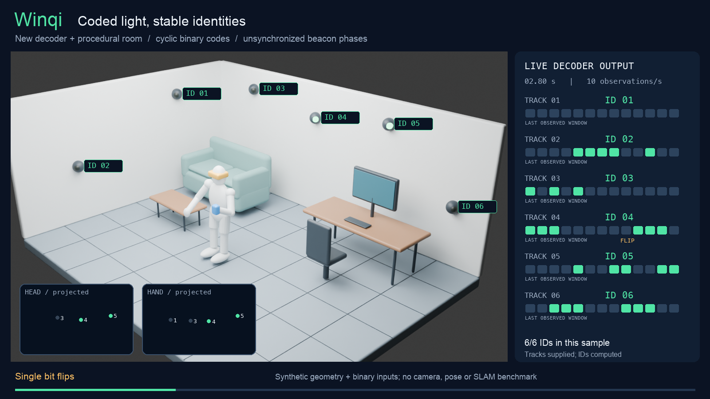

# Winqi: coded light beacons for localization

Winqi gives light beacons an identity by the binary patterns they blink. A camera can recognize a beacon from a short observation window even when it starts watching partway through the pattern. Those IDs turn otherwise similar points of light into known landmarks for estimating position and orientation, and for augmenting SLAM.

The research began with **Winqi (Wetzler and Kimmel, 2017)** and developed into **CoBe (Rabinovich, Jubran, Wetzler and Kimmel, 2020)**. This repository provides the original code-generation experiments, a runnable Python implementation of beacon identification, and a new explanatory animation. The full camera/localization system is available in the [CoBe repository](https://github.com/baklawe/CoBe).

[](media/winqi-demo.mp4)

[Watch the 12-second demonstration](media/winqi-demo.mp4) · [Rebuild the Blender scene](media/README.md)

Six wall beacons repeat 13-bit codes, viewed from room, head-camera and hand-camera perspectives. The displayed bit windows and IDs are computed by the decoder from synthetic observations, including flipped, missed and duplicated bits; tracks and scene geometry are supplied. The presentation follows Dani Epstein’s 2016 Winqi animation, with newly generated geometry. [Media details and credits](media/README.md).

## How it works

1. **Emit a repeating signature.** Each LED cycles through a binary code, represented by two light intensities or colors. Cyclic shifts represent the same beacon, so identification needs no shared codeword start signal.
2. **Recognize the beacon despite observation errors.** Codebook construction groups every cyclic phase with its allowed single-bit flip, insertion and deletion variants. It chooses codes whose groups do not overlap. A sliding window of received bits can then map directly to a beacon ID through a lookup table.
3. **Use identified landmarks for localization.** In the research system, a calibrated camera matches beacon image locations to their mapped 3D positions to estimate six-degree-of-freedom pose. The identified landmarks can also support SLAM. This repository’s Python component implements the codebook and binary-stream decoding stage.

See [Winqi, Sections 2–3](https://arxiv.org/html/1708.05625v1) for the system and coding method. Code length sets the observation window needed for initial identification; longer codes trade longer lock-on time for more available beacon IDs. The [Python model guide](updated/README.md#model-and-limits) defines its exact error variants and operating limits.

## Papers and experimental results

- **Original Winqi:** [Winqi: A System for 6D Localization and SLAM Augmentation Using Wideangle Optics and Coded Light Beacons](https://arxiv.org/abs/1708.05625v1). Aaron Wetzler and Ron Kimmel, August 2017. The preliminary paper introduces the system, cyclic code construction and lock-on analysis.
- **Later CoBe:** [CoBe — Coded Beacons for Localization, Object Tracking, and SLAM Augmentation](https://arxiv.org/abs/1708.05625v3). Roman Rabinovich, Ibrahim Jubran, Aaron Wetzler and Ron Kimmel, April 2020; [IEEE CASE 2020](https://doi.org/10.1109/CASE48305.2020.9216779). CoBe is the expanded, retitled revision of the same arXiv record, with a hardware implementation and real-world experiments.

The **CoBe paper’s experiments** used 15-bit infrared beacons, a filtered PS-Eye3 camera and a Raspberry Pi. In controlled tests on a 1.2 × 1.2 m rail trajectory and a servo rotating in 5° steps, the authors report errors up to **five times smaller** than an A3 chessboard comparison using the same camera and PnP pose solver. They also demonstrate fast-moving toy-car tracking, reacquisition after occlusion, and tracking in a two-story staircase with 16 beacons. These results belong to that hardware system and experimental setup. See [CoBe, Sections V-C–VI](https://arxiv.org/html/1708.05625v3#S5.SS3), its [implementation](https://github.com/baklawe/CoBe), and its [real-world demonstration video](https://drive.google.com/file/d/1yD-4W4hqaIUhafevhDh9sYz2IfJK64dn/view).

## Try the decoder

From the repository root, use **Python 3.10 or later**. The core, CLI and tests use only the standard library.

```sh
# Decode two repetitions of beacon 2’s code using the supplied codebook.
python3 -m updated.cli decode --codebook updated/artifacts/codebook.json 00000000011110000000001111

# Generate a synthetic six-beacon trace and run the checks.
python3 -m updated.cli simulate --out simulation.json
python3 updated/run_checks.py
```

The decode command returns JSON: it reports `warming_up` before 13 observations, then identifies beacon 2. To generate your own codebook or understand the stream interface, see the [Python guide](updated/README.md).

**Checks in this repository:** 15 tests cover 5,070 synthetic single-fault stream cases, decoder/CLI behavior, and exact matches to five historical codebook/dictionary array fixtures under their older model. The default deterministic `simulate` trace samples six beacons at 10 Hz for 12 seconds and has 648 correct post-warmup decisions, with no unknown or incorrect post-warmup decisions. The animation displays each sample for three frames at 30 fps. See the [recorded results](updated/validation/test-results.json) and [test coverage](updated/README.md#validation).

These checks measure binary-stream decoding with supplied tracks. The Python core expects binary observations and track association; image detection, background rejection, clock/rate estimation and pose/SLAM are outside its scope. Multiple errors in one window can produce a wrong or unknown ID, and static lights are not rejected. Camera and localization measurements are reported in the CoBe paper above.

## Explore the code

| Start here | Contents |
| --- | --- |
| [Python core and CLI](updated/README.md) | Codebook generation, streaming identification, simulation and tests |
| [Original MATLAB experiments](source/original/matlab/) | Code generation and decoding, including [genCodesCyclic.m](source/original/matlab/genCodesCyclic.m), [genNoise.m](source/original/matlab/genNoise.m) and [decodeEditDistance.m](source/original/matlab/decodeEditDistance.m) |
| [Original saved tables](source/original/tables/) | Codebooks and dictionaries; read the [revision and value conventions](docs/ORIGINAL_TABLES.md) before use |
| [Animation and Blender scene](media/README.md) | MP4, poster, procedural scene and rebuild commands |
| [CoBe application](https://github.com/baklawe/CoBe) | Camera tracking, mapping/localization and beacon firmware |

Historical files are hash-verified; their MATLAB experiments have not been re-executed. Archive inventories, dependencies and recovery details are in [the provenance guide](docs/PROVENANCE.md) and [archive validation](docs/ORIGINAL_VALIDATION.md). Licensing is per component; see [NOTICE](NOTICE.md).
